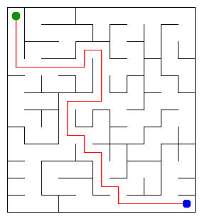

# Assignment 3. Maze Escape

Student ID: 254605
Name: Kassen Alikhan
Group: SE2540
Maze size (rows x columns): 12х11

This file is the report. Fill it in as you go. How to start: `START_HERE.md`. The task: `docs/Assignment3.pdf`.

## Program output

The 13 lines your program prints on your data (`java -cp out Main`):

    Broken: 131
    Kept: 110
    Last broken wall: 192
    MST cost: 38407
    Heaviest broken wall: 707
    Path length: 27
    DFS visited: 98
    Dead ends: 33
    Zones: 10
    Largest zone: 21
    Is DAG: 0
    Flow stages: 7
    Fastest route cost: 11

My maze:

## Questions

Answer in your own words, two or three sentences each.

Mission 0. Find in DSU is an algorithm that searchs root vertice of the leaf and compresses it, union is used for creating subsets of connected vertices. It hangs tree with smaller rank under a tree with bigger rank 

Mission 1. At the start there is R*C cells, every union decrease number of groups by 1. 

Mission 2. 38407, there is only one MST, because of the different costs of every path so MST is only one.

Mission 3. union wouldn't create cycle and the number of edges are R*C-1, so it's a tree. Deep recursion would cause stackoverflow exception in big matrice, like 1000X1000

Mission 4. Kosaraju does two traversals to find SCC, and to detect them we reverse the direction of slides. Going from end point of the previous traversal (top of the stack) to start point of it (end of the stack). Cycles create zone of connected vertices and decreases number of zones, without them every vertice would have it's own zone 

Mission 5. We go in topological order, 1 -> 2 -> z and by that we go through every zone we have. Every zone and slide we look once O(V+E)

## AI use

Claude was used for code review, bug checking, explaining details of assignment and algorithms. 

## Timing (Mission 7)

Milliseconds, 5 runs each, from `java -cp out Bench`.

| maze | Kruskal | Prim |
|---|---|---|
| 100 x 100 | 13 8 10 16 13  avg 12 | 20 7 9 7 8  avg 10 |
| 300 x 300 | 93 66 55 37 36  avg 57 | 90 84 81 84 81  avg 84 |
| 1000 x 1000 | 710 694 779 657 667  avg 701 | 1936 1988 1902 2000 1893  avg 1944 |

Time grows n log n and around, kruskal increases 4x times and then 12x, prim grows 8x times and then 12x 

## Complexity

n is the number of cells, m the number of walls (or slides). Fill in every algorithm you wrote.

| algorithm | time | space | assumptions |
|---|---|---|---|
| DSU find and union | O(1) | O(1) | DSU is ammortized so it can take constant time  |
| Kruskal | O(m log m) | O(n + m) | sorting is dominating so it is O(n log n) |
| Prim | O(mlog m) | O(n+m) | in priorityqueue we can have old edges, until 2m |
| DFS | O(n+m) | O(n) | cell doesn't have more than 4 neighbours so contains is constant, maze is a tree, therefore edges are n - 1 |
| Kosaraju | O(n+m) | O(n+m) | two traversal with DSF and stack, every slide and cell is constant time |
| Route in the zone graph | O(n+m) | O(n+m) | zones are already sorted, one traversal without priorityqueue |

## Before you submit

- data/walls.txt, data/slides.txt and output/maze.png are in the repository.
- `java tools/Check.java` shows all examples right.
- This README is filled in, the program output and the section AI use included.
- The work is pushed to main (at least one commit per mission) and the repository is public.
- The link is attached in Moodle.
